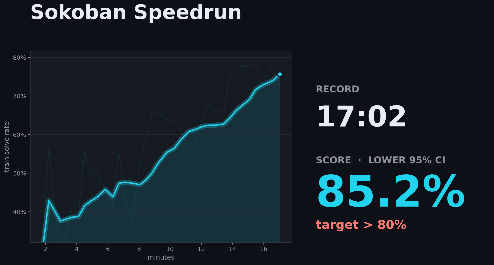
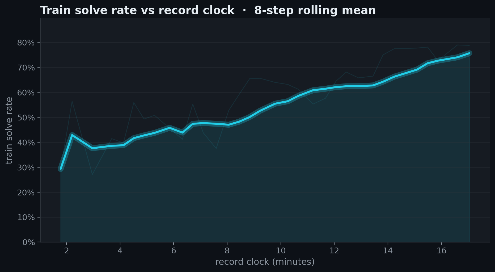
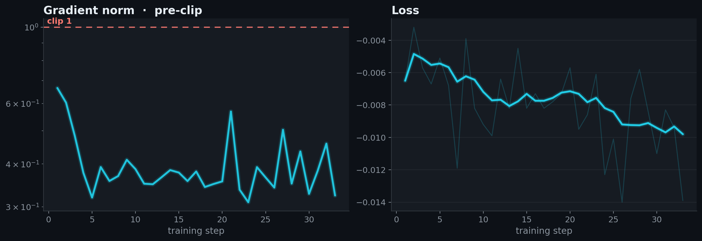
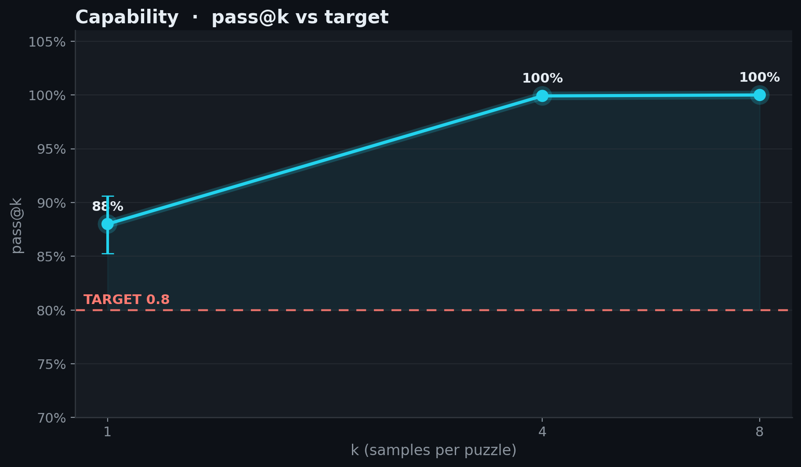

# 2026-10-12_01_reinforce_fp8_33step

## Idea

Replace the previous record's CISPO objective with group-centered REINFORCE:
each generated token's log-probability is weighted by its rollout's shaped
advantage, with sequence-mean normalization and no importance-ratio weighting
or clipping. The Weco advantage shaping is retained. This is an asynchronous,
potentially off-policy update, not a claim of an unbiased on-policy estimator.
Behavior log-probabilities use vLLM's processed sampling distribution for
diagnostics only; they do not enter the REINFORCE gradient (`kl_tau=0`).

Relative to [the 35-step CISPO record](../2026-07-15_01_weco_cispo_35step/),
this recipe also uses four trainers + four rollout GPUs instead of three + five,
FP8 KV cache with unchanged BF16 sampler weights, logits chunks of 1024 instead
of 2048, and 33 updates instead of 35. The difficulty-weight ramp retains its
35-step horizon; the learning-rate schedule is unchanged (peak 1.6e-6, five
warmup steps, 60-step decay horizon). W&B, training-rollout saving, and entropy
logging are disabled; per-step metrics and final-evaluation rollouts are saved.
There is no score centering, entropy bonus, prompt modification, reward change,
or Sokoban-specific heuristic.

The additional trainer and shorter run reduce training work on the critical
path; FP8 KV cache helps the four-GPU rollout side keep up. These two qualifying
runs validate the combined recipe, not the causal contribution of each change.

Seed42 completes in **1022.4475 s (17:02.45)** with pass@1 **0.8800** and
95% CI **[0.8525, 0.90625]**. The independently trained seed43 completes in
**1035.7852 s (17:15.79)** with pass@1 **0.8525** and CI
**[0.81746875, 0.88625]**. The leaderboard uses seed42's time and the worse
lower confidence bound, **0.81746875**. Both runs use one strict 8xH100 Modal
node, with the unchanged official evaluation: 100 puzzles, eight samples per
puzzle, 12,288-token budget, temperature 0.8, top-p 0.95, sampling seed 12345.
Evaluation retains the default BF16 KV cache. The record clock excludes setup,
checkpoint saving, and final evaluation, as defined by the benchmark.

### Provenance and reproduction

Both runs were launched from commit `5436466` with the recipe already baked
into `speedrun.py`; the only training arguments were run name and seed.
Modal containers do not include the Git checkout, so the original artifacts
report a null Git commit. They are preserved unmodified: both embedded source
snapshots match each other and the submitted `speedrun.py` byte-for-byte
(SHA256 `7da94fcf605e8f57c47bc24aed46981ccf31e1b32e2b695842bf0a8bde6fe1db`).

- Submission: `reinforce-clean-record-s42-33-20261012-r2`,
  [Modal run](https://modal.com/apps/sokobanspeedrun/main/ap-LUYATLgBziySAodEm0I1rw).
- Verification: `reinforce-clean-record-s43-33-20261012-r2`,
  [Modal run](https://modal.com/apps/sokobanspeedrun/main/ap-rcPl1hoSl3eIdiEpvzQtvX).

The initial clean-launch attempts failed before training because of a Modal
secret-dependency mismatch. They were stopped, the launcher was fixed, and
these two runs were launched with the same training source and recipe. Neither
completed run was retried or extended based on its score.

Use the local reproduction commands below, or launch on Modal from `llm/`
after configuring the `huggingface-secret` (`HF_TOKEN`) and `wandb-secret`
(`WANDB_API_KEY`, `WANDB_ENTITY`) secrets (the shared launcher requires both,
although this recipe does not send W&B logs):

```bash
RUN_NAME=reinforce-record-s42 EXTRA_ARGS='--seed 42' FINAL_EVAL_K=8 FINAL_EVAL_LIMIT=0 FINAL_EVAL_SEEDS=12345 uv run modal run --detach modal_app.py
RUN_NAME=reinforce-record-s43 EXTRA_ARGS='--seed 43' FINAL_EVAL_K=8 FINAL_EVAL_LIMIT=0 FINAL_EVAL_SEEDS=12345 uv run modal run --detach modal_app.py
```

The launcher defaults to eight H100s and four trainers, runs final evaluation,
and exits automatically. No recipe overrides are needed. The checked-in logs,
metrics, source snapshots, evaluation JSONs, and compressed evaluation rollouts
were assembled with `assemble_record.sh` and re-scored with `verify_record.py`.
All 1,600 saved completions, both source snapshots, and evaluation dataset
hashes pass verification.

<!-- BEGIN AUTO-GENERATED by make_record_report.py — edits inside will be overwritten -->

## Results

| seed | held-out eval pass@1 | 95% CI | record clock |
|---|---|---|---|
| seed42 | 0.8800 | [0.8525, 0.9062] | 17:02 |

**Held-out eval pass@1 0.8800, lower 95% CI 0.8525 vs TARGET 0.8: CLEARS.**





<details><summary>diagnostic plots</summary>





</details>

## Verification

@lorenzflow; independent seed43 rerun of the same baked 33-step REINFORCE recipe on Modal 8xH100, four trainers + four generators:

- re-ran at seed43 → pass@1 **0.8525** (95% CI [0.8175, 0.8862]) — **CLEARS 0.8** ✓

Confirms the recipe reproduces independently; the record time above is the submission run's, not this rerun's. Artifacts: [`verification/`](verification/).

## Source

Standalone `speedrun.py` snapshots are saved per run and checked against the embedded run-log source.

| run | seed | snapshot | sha256 |
|---|---|---|---|
| submission | seed42 | [source/speedrun_seed42.py](source/speedrun_seed42.py) | `7da94fcf605e` |
| verification | seed43 | [verification/source/speedrun_seed43.py](verification/source/speedrun_seed43.py) | `7da94fcf605e` |

## Config

| arg | value |
|---|---|
| `loss_fn` | `reinforce` |
| `advantage_mode` | `centered` |
| `device_batch_size` | `2` |
| `logits_chunk_size` | `1024` |
| `vllm_kv_cache_dtype` | `fp8` |
| `behavior_logprobs_mode` | `processed` |
| `learning_rate` | `1.6e-06` |
| `lr_schedule` | `linear` |
| `min_lr_frac` | `0.15` |
| `lr_decay_steps` | `60` |
| `warmup_steps` | `5` |
| `cispo_eps` | `4.0` |
| `loss_normalization` | `sequence` |
| `adv_centered_blend` | `0.04` |
| `adv_difficulty_weight` | `0.18` |
| `adv_difficulty_ramp` | `1.0` |
| `adv_difficulty_schedule_steps` | `35` |
| `adv_variance_boost` | `1.1` |
| `examples_per_step` | `16` |
| `num_samples` | `8` |
| `max_new_tokens` | `4800` |
| `temperature` | `0.8` |
| `top_p` | `0.95` |
| `max_staleness` | `4` |
| `inflight_requests` | `64` |
| `interruption` | `True` |
| `interrupt_answer_tokens` | `512` |
| `max_steps` | `33` |
| `seed` | `42` |

<details><summary>full args</summary>

```json
{
  "adam_eps": "1e-15",
  "adv_centered_blend": "0.04",
  "adv_difficulty_ramp": "1.0",
  "adv_difficulty_schedule_steps": "35",
  "adv_difficulty_weight": "0.18",
  "adv_variance_boost": "1.1",
  "advantage_mode": "centered",
  "attn_implementation": "flash_attention_2",
  "auto_run_name": "False",
  "behavior_logprobs_mode": "processed",
  "cispo_eps": "4.0",
  "clip_eps_high": "None",
  "clip_eps_low": "None",
  "clip_ratio_c": "None",
  "compile": "False",
  "debug_assert_replica_sync": "False",
  "device": "",
  "device_batch_size": "2",
  "dtype": "float32",
  "enable_thinking": "False",
  "entropy_coef": "0.0",
  "eval_data": "datasets/sokoban_eval.jsonl",
  "examples_per_step": "16",
  "final_rollout_steps": "0",
  "grad_clip": "1.0",
  "gradient_checkpointing": "True",
  "inflight_requests": "64",
  "init_lr_frac": "0.05",
  "interrupt_answer_tokens": "512",
  "interrupt_max_tokens": "None",
  "interrupt_min_tokens": "None",
  "interrupt_temperature": "None",
  "interrupt_top_k": "None",
  "interrupt_top_p": "None",
  "interruption": "True",
  "kl_tau": "0.0",
  "learning_rate": "1.6e-06",
  "log_entropy": "False",
  "logits_chunk_size": "1024",
  "loss_fn": "reinforce",
  "loss_normalization": "sequence",
  "lr_decay_start": "None",
  "lr_decay_steps": "60",
  "lr_schedule": "linear",
  "max_model_len": "6144",
  "max_new_tokens": "4800",
  "max_staleness": "4",
  "max_steps": "33",
  "min_lr_frac": "0.15",
  "model": "Qwen/Qwen3-4B-Instruct-2507",
  "num_epochs": "1",
  "num_samples": "8",
  "optimizer": "adamw",
  "output_dir": "outputs",
  "rollout_flush_every": "10",
  "run": "reinforce-clean-record-s42-33-20261012-r2",
  "save_every": "0",
  "save_final": "True",
  "save_rollouts": "False",
  "seed": "42",
  "temperature": "0.8",
  "top_k": "0",
  "top_p": "0.95",
  "train_autocast_dtype": "bfloat16",
  "train_data": "datasets/sokoban_train.jsonl",
  "trim_after_answer": "True",
  "trust_remote_code": "False",
  "verify_datasets_only": "False",
  "vllm_enable_chunked_prefill": "None",
  "vllm_enforce_eager": "False",
  "vllm_gpu_mem_util": "0.9",
  "vllm_kv_cache_dtype": "fp8",
  "vllm_long_prefill_token_threshold": "None",
  "vllm_max_long_partial_prefills": "None",
  "vllm_max_num_batched_tokens": "8192",
  "vllm_max_num_partial_prefills": "None",
  "vllm_max_num_scheduled_tokens": "None",
  "vllm_max_num_seqs": "512",
  "vllm_performance_mode": "None",
  "vllm_scheduler_reserve_full_isl": "None",
  "vllm_stream_interval": "8",
  "wandb": "False",
  "wandb_rollout_samples": "0",
  "warmup_steps": "5",
  "weight_decay": "0.01",
  "zero_variance_filter": "True"
}
```
</details>

## Reproduce

```bash
# train on one 8xH100 node (the recipe is baked into speedrun.py's RECIPE — no recipe flags)
NODE_GPUS=8 uv run torchrun --standalone --nproc_per_node=4 -m speedrun --run <run> --seed <seed>
# eval the final checkpoint under the leaderboard protocol, then verify offline
uv run python -m eval_speedrun --run <run>-final-eval --eval-checkpoint outputs/<run>/step_<final> --eval-k 8 --eval-seed 12345 --eval-limit 0 --eval-max-tokens 12288 --eval-max-model-len 16384 --eval-interruption --eval-interrupt-answer-tokens 512 --eval-vllm-dp 8 --eval-gpu-mem-util 0.9 --eval-vllm-max-num-batched-tokens 40960 --eval-vllm-max-num-seqs 32 --eval-concurrency 32
uv run python verify_record.py records/2026-10-12_01_reinforce_fp8_33step
```

<!-- END AUTO-GENERATED -->


